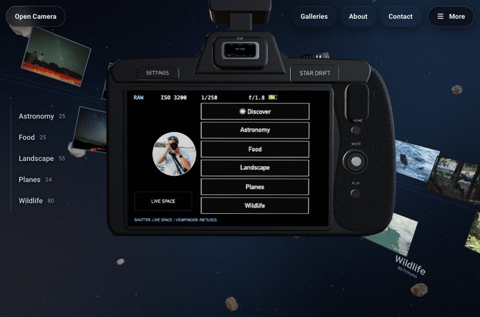
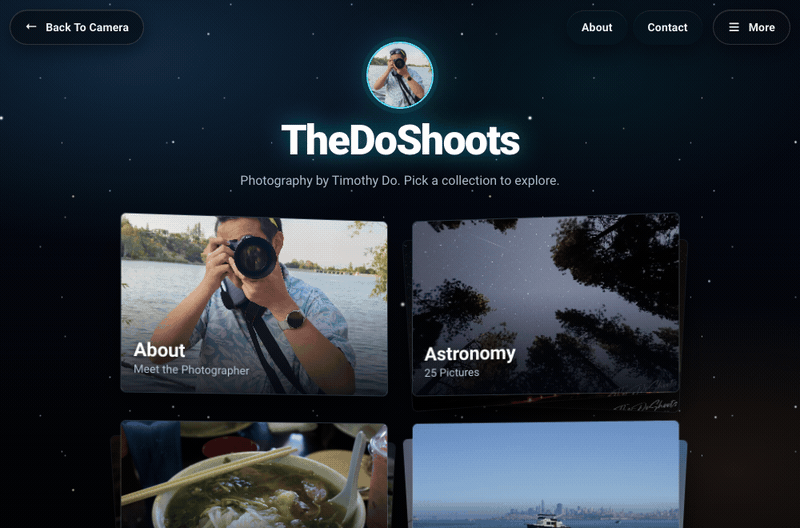
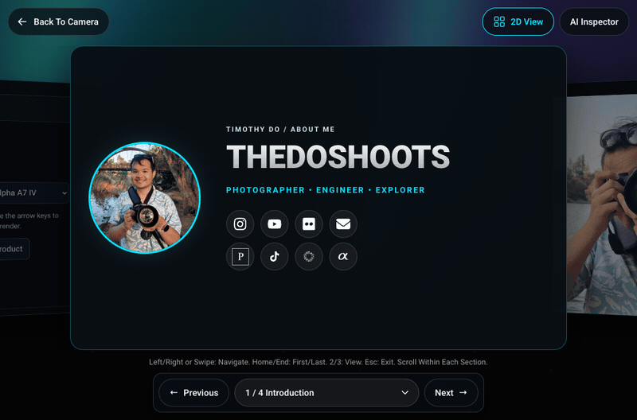

# 📷 TheDoShoots Photography Portfolio

Explore Timothy Do’s Astronomy, Food, Landscape, Planes, and Wildlife collections. Start at the interactive camera in space, or go straight to the gallery wall to browse the pictures. [Visit TheDoShoots](https://thedoshoots.me)

## Walk through the portfolio

### Open the 3D camera

Choose **Explore Portfolio** to enter the scene. Select **Open Camera** or press **B** to move up to the rear display. Pick a collection on the display, or use **Exit Camera View** to pull back.



### Browse an album and inspect a picture

Choose **Galleries** to open the 2D gallery wall. This walkthrough enters Astronomy, opens a picture from the grid, and uses the information button to reveal its camera settings. Inside an album, **Grid** and **3D** switch how the collection is arranged. [Open the gallery wall](https://thedoshoots.me/?mode=2d)



### Explore About Me and the Gear Bag

In the 3D About view, use the section picker or arrow buttons to move through **My Story**, **About Me**, and **Gear Bag**. Select a camera, lens, or phone, then drag the render to turn it. When the render has keyboard focus, the arrow keys rotate it too. **View Product** opens the manufacturer’s page. [Open About in 3D](https://thedoshoots.me/about.html?mode=3d)



## Settings and TheDoInspector

Open **More** on desktop or **Menu** on mobile, then choose **Settings** for gallery preferences such as Data Saver and fullscreen. **AI Inspector** opens TheDoInspector. Its model controls let you select a model, adjust temperature and maximum generated tokens, and load or unload the model. In chat, `/load` loads the selected model and `/unload` releases its memory while keeping the downloaded files.

## Build locally

The builder uses Python 3, Git, and the gallery template to generate a static site. From the repository root on macOS or Linux, create a virtual environment, install the dependencies, and build the portfolio.

```sh
python3 -m venv .venv
. .venv/bin/activate
python -m pip install -r requirements.txt
python preparePortfolio.py --watermark
```

Serve the generated `build/` directory with your local web server. Each collection lives under `build/portfolios/<collection>/`, with a gallery page, full-size pictures, thumbnails, and metadata. The gallery template comes from [dotimothy/gallery](https://github.com/dotimothy/gallery).

| Task | Builder arguments |
| --- | --- |
| Build only Astronomy and Wildlife | `--select astronomy wildlife` |
| Refresh pages and scripts after an image build | `--html-only` |
| Use a local gallery template checkout | `--gallery-source ../gallery --html-only` |
| Set output JPEG quality and parallel workers | `--quality 85 --jobs 4` |
| Rebuild generated gallery assets while keeping full-size pictures | `--clean` |

Run `python preparePortfolio.py --help` for all options. Run the unit tests with `python -X utf8 -m unittest discover -s tests`.

### Where to make changes

| Path | Purpose |
| --- | --- |
| `index.html` | The 3D camera, 2D gallery wall, and portfolio settings |
| `about.html` | Profile, About carousel, and Gear Bag |
| `assets/` | Interface styles, browser scripts, and the portfolio picture list |
| `vlm/` | TheDoInspector interface and model integration |
| `preparePortfolio.py`, `modules/` | Gallery generation, image processing, and metadata |

To change an album’s 3D shape, edit `GALLERY_SHAPE_EMOJIS` in `preparePortfolio.py`. Each entry sets the shape independently of the album title emoji. Removing an entry uses the template’s default sphere. The 2D layout stays a grid.

## License and contact

Photographs © 2026 Timothy Do are licensed under **CC BY-NC-ND 4.0**. The source code uses the **MIT License**. [Read the licenses](LICENSE)

Get in touch with Timothy Do through the [portfolio contact page](https://thedoshoots.me/contact.html) or [@dotimothy on GitHub](https://github.com/dotimothy).
